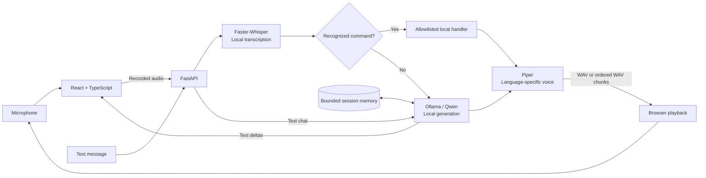

<div align="center">


# Trikon Voice AI

**A local-first voice assistant that listens, thinks, and speaks on your machine.**

English & Hindi · Streaming responses · Hands-free conversations · Local inference


[Watch the demo](#-demo) · [Explore features](#-features) · [Get started](#-quick-start) · [Architecture](#-architecture) · [API](#-api-reference)

</div>

---

## 🎬 Demo


https://github.com/user-attachments/assets/d4d64adf-8817-4738-82f7-5de926539b6e


[Download the demo MP4](https://github.com/vigneshwar0246/trikon-ai-assistant/blob/main/artifacts/demo/voice-ai-demo-cut.mp4)

Watch the demonstration to see Trikon Voice AI handle voice input, local AI responses, and spoken output.

Press **Play** to watch the full demo with its original audio. The embedded player provides playback, seeking, volume, and fullscreen controls in Markdown viewers that support HTML video. If your viewer blocks embedded media, use the video link above or open [the local browser player](docs/demo.html).

**GitHub rendering:** the repository-relative video above does not enable GitHub's inline attachment player. To play with sound inside the GitHub README, upload the MP4 using the steps below and replace this video block with the generated attachment URL.

<details>
<summary><strong>Enable a playable video directly inside this README on GitHub</strong></summary>

GitHub's inline attachment player needs a GitHub-hosted video attachment URL. A relative repository MP4 link is a fallback, not a guaranteed inline player.

1. Open this README in GitHub's web editor.
2. Drag `artifacts/demo/voice-ai-demo-cut.mp4` into the Demo section and wait for the upload to finish.
3. Keep the generated `https://github.com/user-attachments/assets/...` URL on its own line, preview the README, and save the change.

The supplied video is below GitHub's 10 MB free-plan video attachment limit. No conversion is needed. See [GitHub's attachment documentation](https://docs.github.com/en/get-started/writing-on-github/working-with-advanced-formatting/attaching-files) and the [README video discussion](https://github.com/orgs/community/discussions/19403).

</details>

## ✨ Features

| Capability | What the project does |
|:---|:---|
| 🎙️ Voice-to-voice chat | Records browser audio, transcribes locally, generates an answer, and plays synthesized speech. |
| 💬 Text conversations | Talks to a local Ollama model with bounded, session-aware conversation history. |
| 🌐 English & Hindi | Dedicated language controls persist the choice in the browser and session; each language uses its configured Piper voice. |
| ⚡ Incremental responses | Streams Ollama text deltas and plays ordered WAV chunks synthesized at sentence or phrase boundaries. |
| 👐 Hands-free mode | Listens for speech, submits on a pause, speaks the answer, and resumes listening while the page remains open. |
| ⏸️ Interruption controls | Optional barge-in interrupts playback and captures a new turn; mute, stop speech, and stop listening are available. |
| 🧭 Local voice commands | Handles time, status, repeat, clear conversation, and stop listening through explicit command routing. |
| 📊 Measured performance | Shows STT, LLM, TTS, and total timings alongside service connection and readiness information. |
| 🖥️ Runtime diagnostics | Reports model readiness, configured and last successful STT device, CUDA checks, hardware, and Ollama VRAM information. |
| 🎨 React interface | Includes an introduction, dashboard, conversations, settings, and about views, with a voice orb and motion effects. |

**Inference stays local** when using the default local service configuration. The runtime uses Faster-Whisper, Ollama, and Piper rather than paid hosted inference APIs. Initial package/model installation requires downloads; startup, health checks, and tests do not download models automatically.

> [!NOTE]
> The custom **“Carrot” wake word is not active**. Training/evaluation scaffolding exists, but a validated detector is not integrated. Current hands-free mode uses speech activity and silence detection.

## 🧠 Architecture



The standard voice endpoint returns the transcript, answer, audio URL, and timings together. The streaming endpoint emits newline-delimited JSON events as text and speech chunks become available. **Piper synthesis is chunked, not native audio streaming.** Successful turns share in-memory session history; incomplete streamed assistant turns are not committed.

| Layer | Technology |
|:---|:---|
| Interface | React 19, TypeScript, Vite 7, React Router 7 |
| Styling & motion | Tailwind CSS 4, Framer Motion, Lucide icons |
| API & validation | FastAPI, Uvicorn, Pydantic, HTTPX |
| Speech recognition | Faster-Whisper 1.2.1, CTranslate2, PyAV 16.0.1 |
| Language model | Ollama HTTP API; `qwen2.5:3b` by default |
| Speech synthesis | Piper 1.8.0; English Norman and separately configured Hindi Pratham |
| Verification | pytest, Vitest, Testing Library, ESLint, TypeScript build; Playwright demo tooling |

## 🚀 Quick start

The documented development workflow uses **Windows 11 and PowerShell**. Install **Python 3.11**, **Node.js 22.12+ with npm**, and **Ollama**. CPU speech recognition is supported; GPU use depends on compatible runtime libraries. Model storage and memory requirements depend on your chosen models.

### 1. Clone and install the backend

```powershell
git clone https://github.com/vigneshwar0246/trikon-ai-assistant.git
cd trikon-ai-assistant
cd backend
py -3.11 -m venv .venv
.\.venv\Scripts\Activate.ps1
python -m pip install --upgrade pip
python -m pip install -r requirements.txt
Copy-Item .env.example .env
```

If you already have the project, start in its `backend` directory. Copy environment examples only for a fresh setup; preserve existing local configuration.

### 2. Prepare the local language model

Start Ollama if its desktop service is not already running:

```powershell
ollama serve
```

In another terminal:

```powershell
ollama pull qwen2.5:3b
ollama list
```

Text chat needs Ollama and the selected model. Speech additionally needs the following model downloads.

### 3. Install speech models

Run from `backend/` with the virtual environment active:

```powershell
python -m pip install huggingface-hub
hf download Systran/faster-whisper-base --local-dir models/faster-whisper-base
python -m piper.download_voices en_US-norman-medium --download-dir models/piper
```

<details>
<summary><strong>Hindi speech setup</strong></summary>

Download the multilingual recognition model and Hindi voice explicitly:

```powershell
hf download Systran/faster-whisper-small --local-dir models/faster-whisper-small
python -m piper.download_voices hi_IN-pratham-medium --download-dir models/piper
```

Configure `backend/.env`:

```dotenv
STT_MULTILINGUAL_MODEL_PATH=models/faster-whisper-small
TTS_HI_MODEL_PATH=models/piper/hi_IN-pratham-medium.onnx
TTS_HI_CONFIG_PATH=models/piper/hi_IN-pratham-medium.onnx.json
```

Restart FastAPI, check `/api/health`, and test a Hindi turn. Hindi never silently falls back to the English voice. Review each downloaded model's terms before redistribution.

</details>

### 4. Install the frontend

In a new terminal, from the repository root:

```powershell
cd frontend
npm ci
Copy-Item .env.example .env
```

### 5. Start the app

Keep Ollama running, then launch the other two services in separate terminals:

| Terminal | Working directory | Command |
|:---|:---|:---|
| Backend | `backend/`, virtual environment active | `uvicorn app.main:app --reload --host 127.0.0.1 --port 8000` |
| Frontend | `frontend/` | `npm run dev` |

**App:** http://localhost:5173 · **API docs:** http://127.0.0.1:8000/docs<br>
**Health:** http://127.0.0.1:8000/api/health · **Diagnostics:** http://127.0.0.1:8000/api/diagnostics

The frontend uses Vite's `/api` proxy by default. Set `VITE_API_BASE_URL` only when the backend uses a different origin. `VITE_*` values are public browser configuration; never put secrets there.

## 🎙️ Using the assistant

1. Confirm that the backend and required models report ready.
2. Select **English** or **Hindi**.
3. Send a text message or record a microphone turn.
4. Read the transcript and response, listen to playback, and inspect stage timings.
5. Enable **hands-free** for repeated spoken turns without pressing record each time.

Hands-free mode requires microphone permission and an open page. It detects speech locally and submits a turn after the selected silence interval: **0.6, 0.9, or 1.4 seconds**. Empty captures are discarded after five seconds; a turn is capped at 12 seconds. Use **Mute** to pause listening, **Stop speech** to end playback, and **Stop hands-free** to release the microphone. Optional interruption lets a new spoken turn interrupt an answer.

| Say | Result |
|:---|:---|
| “What time is it?” | Answers using the machine's local clock. |
| “System status” | Checks the assistant's runtime status. |
| “Repeat that” | Repeats the previous response when available. |
| “Clear conversation” | Clears the conversation. |
| “Stop listening” | Stops hands-free listening. |

These explicit commands bypass general LLM answering. Arbitrary shell execution, launching programs, and deleting files are not supported.

## ⚙️ Configuration

Values below reflect the committed example/default configuration, not every developer's private `.env`. Relative model paths resolve from `backend/`.

| Variable | Default / example | Purpose |
|:---|:---|:---|
| `OLLAMA_BASE_URL` | `http://127.0.0.1:11434` | Local inference service |
| `OLLAMA_MODEL` | `qwen2.5:3b` | Chat model; pull separately |
| `OLLAMA_HI_MODEL` | Optional | Separate installed Hindi chat model; defaults to `OLLAMA_MODEL` when unset |
| `OLLAMA_TIMEOUT_SECONDS` | `120` | Generation timeout |
| `OLLAMA_TEMPERATURE` | `0.1` | Lower-variance generation for concise factual answers |
| `OLLAMA_NUM_CTX` | `2048` | Context window; matches the practical local Qwen 7B runtime budget and lowers prompt latency |
| `VOICE_NUM_PREDICT` / `VOICE_HI_NUM_PREDICT` | `80` / `96` | Spoken-response token ceilings |
| `STT_MODEL_PATH` | `models/faster-whisper-base` | Primary recognition model |
| `STT_MULTILINGUAL_MODEL_PATH` | `models/faster-whisper-small` in example | Optional Hindi recognition model |
| `STT_DEVICE` / `STT_COMPUTE_TYPE` | `cpu` / `int8` | Recognition execution settings |
| `STT_BEAM_SIZE` | `5` | Recognition beam width |
| `STT_LANGUAGE_CONFIDENCE_THRESHOLD` | `0.55` | Auto-detection confidence gate |
| `TTS_MODEL_PATH` | `models/piper/en_US-norman-medium.onnx` | English voice |
| `TTS_CONFIG_PATH` | Model path plus `.json` | Matching voice configuration |
| `TTS_HI_MODEL_PATH` / `TTS_HI_CONFIG_PATH` | Unset until configured | Hindi voice and configuration |
| `TTS_USE_CUDA` | `false` | Piper device preference |
| `AUDIO_MAX_SIZE_MB` / `AUDIO_MAX_DURATION_SECONDS` | `25` / `300` | Upload limits |
| `AUDIO_OUTPUT_DIR` | `generated_audio` | Temporary playback files |
| `SESSION_MAX_TURNS` / `SESSION_MAX_COUNT` | `12` / `500` | In-memory history bounds |
| `LOG_LEVEL` | `INFO` | Backend logging |

See [backend/.env.example](backend/.env.example) and [settings definitions](backend/app/core/config.py) for the complete configuration. CUDA/float16 STT is optional, with CPU/int8 fallback. Use diagnostics to distinguish configured GPU use from a successful GPU transcription; hardware detection alone does not verify inference.

## 🔌 API reference

| Method | Endpoint | Purpose |
|:---|:---|:---|
| `GET` | `/api/health` | API, model, and per-language readiness |
| `GET` | `/api/diagnostics` | Runtime, hardware, CUDA, STT, and Ollama diagnostics |
| `POST` | `/api/chat` | Text turn with optional session/language |
| `POST` | `/api/chat/stream` | NDJSON text deltas, completion metadata, and timings |
| `GET` | `/api/chat/sessions` | List bounded in-memory sessions |
| `DELETE` | `/api/chat/{session_id}` | Clear a session |
| `POST` | `/api/voice` | Multipart audio → transcript, answer, audio URL, timings |
| `POST` | `/api/voice/stream` | NDJSON transcript, text deltas, ordered audio chunks, completion/timings |
| `GET` | `/api/audio/{filename}` | Retrieve a generated WAV while retained |

<details>
<summary><strong>Try text and voice requests from PowerShell</strong></summary>

```powershell
Invoke-RestMethod -Method Post -Uri http://127.0.0.1:8000/api/chat `
  -ContentType 'application/json' `
  -Body '{"message":"Explain local AI simply","session_id":"demo-session"}'
```

With an existing `sample.wav` in the current directory:

```powershell
curl.exe -X POST http://127.0.0.1:8000/api/voice `
  -F "audio=@sample.wav;type=audio/wav" `
  -F "session_id=demo-session" `
  -F "language=en"
```

Voice language overrides accept `en` or `hi`. Omit the override to use session/detection behavior. Inspect the interactive API docs for full request and response schemas.

</details>

## 📊 Recorded performance

The **October 21, 2026** benchmark recorded ten real local voice requests: five short and five long English samples, with no failures. Configuration: Faster-Whisper base **CPU/int8**, Qwen 2.5 3B through Ollama on an **RTX 3050 Laptop GPU**, and Piper Norman **CPU**.

| Input | Warm wall p50 | Warm wall p95 | STT p50 | LLM p50 | TTS p50 |
|:---|---:|---:|---:|---:|---:|
| Short · 3.843 s | 4,086.86 ms | 4,813.11 ms | 2,383.66 ms | 790.05 ms | 976.91 ms |
| Long · 15.569 s | 6,902.12 ms | 7,541.01 ms | 3,202.08 ms | 1,253.89 ms | 2,497.37 ms |

These small-sample results use clean synthesized recordings. They do not establish live microphone latency, noisy-room accuracy, Hindi accuracy, or streaming time-to-first-audio. Separate stage medians need not sum to the wall-clock median.

[Read methodology and limitations](docs/benchmark-results.md) · [Inspect raw measurements](docs/benchmark-2026-10-21.json)

## 🧪 Verification

From `backend/` with the virtual environment active:

```powershell
python -m pytest
python -m compileall -q app tests
```

From `frontend/`:

```powershell
npm test
npm run lint
npm run build
```

Automated tests use fakes or validate behavior without downloading models, requiring Ollama, or requiring a GPU. For real-inference acceptance, follow the [demo script](docs/demo-script.md).

### Windows test workarounds

If pytest reports access denied for `pytest-of-yogap` or another system temporary folder, run from `backend/` with a fresh workspace-local temporary directory:

```powershell
.\.venv\Scripts\python.exe -m pytest tests -q -p no:cacheprovider --basetemp="../.test-temp/pytest-$([guid]::NewGuid())"
```

If Vitest reports a timeout starting its default fork workers, run from `frontend/`:

```powershell
npm test -- --pool=threads --maxWorkers=1
```

### Local verification — 24 October 2026

Verified on this Windows checkout with Node.js 22.19.0 and Python 3.11.9, using the installed models and existing local configuration:

| Check | Result |
|:---|:---|
| Frontend at `http://127.0.0.1:5173` | HTTP 200 |
| Backend health | API, Ollama, STT, and TTS ready; English and Hindi readiness flags true |
| Text chat through the frontend proxy | Real Ollama response received |
| English voice pipeline | Synthetic spoken question transcribed correctly, answered by Ollama, and synthesized by Piper; returned WAV downloaded and verified |
| Backend tests | 38 passed using the temporary-directory workaround above |
| Frontend tests | 19 passed across 4 files using the thread-worker workaround above |
| ESLint and production build | Passed |

This verifies the local services and an English audio round trip. Physical microphone capture, speaker playback, hands-free interaction, and a real Hindi voice turn still need an interactive check. The voice test used generated audio rather than a microphone recording. Test output included an AnyIO deprecation warning and jsdom's unimplemented media-playback notice.

<details>
<summary><strong>Run your own voice benchmark</strong></summary>

Prepare actual audio recordings and update a copy of the example manifest with their paths and reference transcripts. With the backend and models running, execute from `backend/`:

```powershell
python scripts/benchmark_voice.py scripts/multilingual-manifest.example.json --runs 5 --output benchmark.json
```

The example manifest is a template, not bundled test audio. Record the hardware, language, model settings, warm-up state, and failures alongside your results.

</details>

## 🗂️ Project map

```text
Trikon-Voice-AI/
├── frontend/
│   ├── src/pages/              # Dashboard, conversations, settings, intro, about
│   ├── src/components/         # Voice orb, controls, status, performance, layout
│   ├── src/context/            # Shared voice/conversation state
│   ├── src/hooks/              # Browser hands-free capture
│   ├── src/lib/                # API client, audio detection, utilities
│   └── scripts/                # Demo recording tooling
├── backend/
│   ├── app/api/routes/         # Chat, voice, streaming, health, audio serving
│   ├── app/services/           # STT, LLM, TTS, pipeline, sessions, commands
│   ├── app/core/               # Configuration, CUDA setup, logging
│   ├── app/schemas/            # Request and response models
│   ├── tests/                  # Backend verification
│   ├── scripts/                # Benchmarks and demo speech generation
│   └── wakeword/               # Training/evaluation scaffolding; not active
├── docs/                       # Architecture, benchmarks, acceptance guide
│   ├── assets/                 # README banner, poster, animated preview
│   └── demo.html               # Local video player
├── artifacts/demo/
│   └── voice-ai-demo-cut.mp4   # Full project demo
└── scripts/                    # Local acceptance and recording helpers
```

## 🔧 Troubleshooting

| Symptom | Check |
|:---|:---|
| Backend unavailable | Start Uvicorn from `backend/`; check port 8000 and the frontend API configuration. |
| Ollama/model not ready | Run `ollama list`, start the service, and pull the model named in `.env`. |
| Speech recognition unavailable | Check that the configured model folder includes `model.bin`, `config.json`, and vocabulary files. |
| English/Hindi voice unavailable | Check the corresponding `.onnx` and matching `.onnx.json` paths; restart the backend after configuration changes. |
| Microphone blocked | Open on localhost, grant microphone permission, and use a browser supporting MediaRecorder. |
| No automatic playback | Interact with the page and check browser autoplay permission and output device. |
| CUDA configured but unverified | Inspect `/api/diagnostics` and perform a real transcription; CPU fallback may be in use. |
| Old response audio missing | Generate another response; audio retention is temporary. |
| Hands-free captures unwanted sounds | Adjust the silence interval and use headphones or a quieter environment. |

## 🔒 Data, boundaries & current status

- **Conversation memory:** process-local, bounded, and reset when the backend restarts.
- **Input audio:** written temporarily for processing and removed afterward.
- **Output audio:** WAVs older than one hour and files beyond the newest 100 are pruned when another synthesis occurs.
- **Network exposure:** the development backend has no authentication; keep it on localhost or a trusted network.
- **Browser behavior:** hands-free is page-local. Background tabs may be suspended, autoplay can be restricted, and microphone/speaker behavior requires an interactive hardware check.
- **Cancellation:** the browser stops playback and aborts its request; server work already underway may still finish. This does not guarantee immediate GPU compute cancellation.
- **Language scope:** English and Hindi are implemented. Tamil is not an accepted voice API language.
- **Wake word:** Carrot training scaffolding is present; an integrated, validated detector remains future work.
- **Licensing:** this repository currently has no root license file. Dependencies and model/voice assets have their own terms; inspect them before redistribution.

## Hindi latency tuning

**Quality audit:** see [hindi.md](hindi.md) for the later Hindi audit, independent STT/LLM/TTS findings, and regression commands. Hindi responses now wait for complete-answer validation before speech; the measurements below describe the earlier latency experiment and do not represent the current validation path. English retains incremental speech.

Hindi now initializes the Windows CUDA runtime before loading its recognition model, including when Hindi is the first language used after startup. If CUDA fails during transcription, the retry retains the configured Hindi model on CPU and clears cached GPU language models.

`STT_HI_BEAM_SIZE=2` is the default Hindi decoding search width; English continues to use `STT_BEAM_SIZE=5`. Set `STT_HI_BEAM_SIZE=5` in `backend/.env` and restart the backend if recognition accuracy suffers on your recordings. The smaller model was not substituted: Hindi still uses the configured multilingual model. The earlier latency experiment used an 80-character Hindi streaming chunk threshold; complete-answer validation now takes priority over that optimization.

Measured on 24 October 2026 with the RTX 3050 6 GB, CUDA/float16, Faster-Whisper small, Qwen 2.5 3B, and the configured Hindi Piper voice:

| Mean over three warm synthetic Hindi clips | Before | After |
|:---|---:|---:|
| Transcription | 444 ms | 407 ms |
| Server time to first audio | 2,365 ms | 2,220 ms |
| Complete response | 2,365 ms | 2,270 ms |

These are small-sample measurements, approximately **6% earlier first audio**, not a general performance guarantee. Both runs used the same saved audio and fresh conversation sessions. Cold startup is excluded: the first request after the final restart took about 11 seconds while models loaded. Keep the backend and Ollama running between turns to retain loaded models. Check `/api/diagnostics` for `stt.last_successful_device: "cuda"` and a null `fallback_reason` after a real voice request.

The clips contained recognition errors with both settings, and Qwen produced inaccurate/repetitive Hindi answers. Faster decoding does not resolve these quality limits; real microphone recordings and listening tests are still needed. All 43 backend tests passed after these changes.

## Project hashtags

`#TrikonVoiceAI` `#VoiceAssistant` `#LocalAI` `#ConversationalAI` `#SpeechToText` `#TextToSpeech` `#Ollama` `#FasterWhisper` `#PiperTTS` `#FastAPI` `#React` `#TypeScript` `#HindiAI`

## 📚 Further reading

| Document | Contents |
|:---|:---|
| [Architecture & model setup](docs/architecture.md) | Backend flow, installation details, and implementation notes; some historical device/hands-free notes reflect earlier iterations. |
| [Demo & acceptance guide](docs/demo-script.md) | Manual walkthrough and real-inference checks |
| [Benchmark report](docs/benchmark-results.md) | Measurements, hardware context, and caveats |
| [Raw benchmark data](docs/benchmark-2026-10-21.json) | Recorded requests and metrics |
| [Wake-word work](backend/wakeword/README.md) | Carrot model training/evaluation scaffolding |

---

<div align="center">

**Speak naturally. Keep inference local.**<br>
Built with React · FastAPI · Faster-Whisper · Ollama · Piper

[Back to top ↑](#trikon-voice-ai)

</div>
